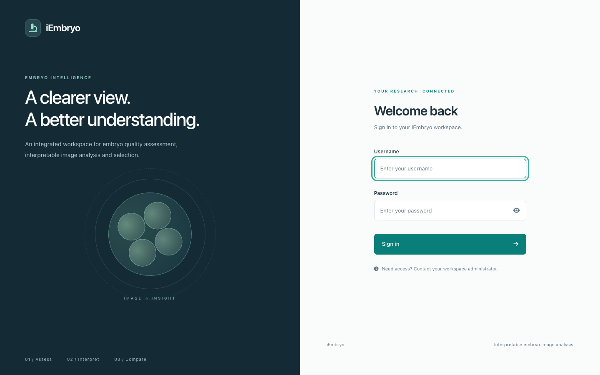

# iEmbryo

iEmbryo is a research workspace for assessing and comparing embryos from IVF microscopy images. It brings together image-based quality assessment, Grad-CAM visualizations, and embryo-level score comparisons across time-lapse image sets. This repository contains the research code for image classification, temporal modeling, and evaluation.

## Web workspace

Open the [iEmbryo workspace](https://iembryo.westlake.edu.cn/) and sign in with your workspace account. Contact your workspace administrator for access.

### Quality assessment

1. Choose **Single File**, **Batch**, or **Folder** in the analysis workspace.
2. Add embryo images and run the analysis. Review the predicted quality scores and Grad-CAM overlays where available.
3. Export batch results as CSV or JSON, or revisit earlier results under **Analysis history**.

### Embryo selection

1. Under **Import embryo images**, add one folder per embryo.
2. Under **Compare quality scores**, calculate the mean first principal component (PC1) score for each embryo and compare the resulting rankings. Use **Export CSV** to save the scores.
3. Under **Explore pregnancy estimates**, select an embryo and enter the requested inputs to explore the model estimate. This step uses a CHAID model with the embryo's PC1 score and patient factors.

## Research code

| Path | Contents |
| --- | --- |
| [`prediction/code/iEmbryo/`](prediction/code/iEmbryo/) | Image-based quality classification, model backbones, training, and evaluation. The main entry point is [`main.py`](prediction/code/iEmbryo/main.py). |
| [`prediction/code/BiLSTM/`](prediction/code/BiLSTM/) | BiLSTM-based modeling of time-lapse embryo image sequences. |
| [`prediction/code/iEmbryo/visualization/`](prediction/code/iEmbryo/visualization/) | Grad-CAM and related visualization tools. |
| [`prediction/code/iEmbryo/unified_pca_analysis.py`](prediction/code/iEmbryo/unified_pca_analysis.py) | Principal component analysis of image features. |
| [`api/code/`](api/code/) and [`data_cleaning/code/`](data_cleaning/code/) | Data retrieval scripts and preprocessing notebooks. |

The image model code includes VGG, ResNet, DenseNet, InceptionV3, and Vision Transformer backbones. The [training code](prediction/code/iEmbryo/training/) supports mixed precision, distributed training, and focal loss. The [cross-validation code](prediction/code/iEmbryo/evaluation/cross_validation.py) reports classification metrics including accuracy, precision, recall, F1, ROC AUC, and confusion matrices.

## Contact

iEmbryo is developed by the Liuxiaodong Lab at Westlake University. For research and collaboration inquiries, contact [liaozizhuo@westlake.edu.cn](mailto:liaozizhuo@westlake.edu.cn).
