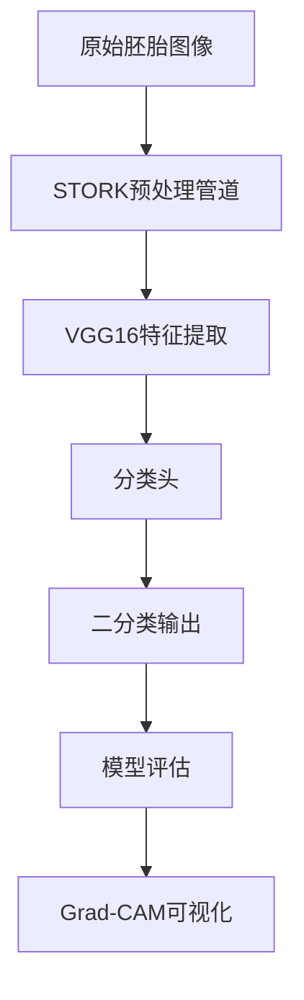

# STORK + VGG16 胚胎分类模型

本文档记录了基于STORK胚胎图像预处理和VGG16深度学习的胚胎分类模型的完整架构和流程。

## 模型概述

### 目标
对胚胎图像进行二分类，判断胚胎是否具有发育潜能（viable/non-viable）。

### 核心技术
- **STORK胚胎图像预处理**：专业的胚胎学图像处理管道
- **VGG16迁移学习**：基于ImageNet预训练的深度卷积神经网络
- **Grad-CAM可视化**：注意力热力图分析

## 整体架构流程



## 1. 数据预处理模块

### 1.1 STORK预处理管道 (`preprocessing/stork_image_utils.py`)

#### 核心函数：
- **`crop_petri_dish()`**: 使用Hough圆检测识别并裁剪培养皿
- **`crop_center_square()`**: 中心方形裁剪，保持胚胎居中
- **`preprocess_embryo_image()`**: 完整的胚胎图像预处理流程
- **`batch_process_images()`**: 批量图像处理

#### 处理流程：
```
原始图像 → 培养皿检测与裁剪 → 中心方形裁剪 → 尺寸调整(224×224) → RGB格式转换
```

### 1.2 数据加载器 (`preprocessing/data_loader_vgg16.py`)

#### 主要功能：
- **固定数据分割**：70%训练集 - 15%验证集 - 15%测试集
- **STORK+VGG16整合预处理**：`preprocess_image_stork_vgg16()`
- **训练时数据增强**：轻量级增强保护胚胎诊断特征
- **VGG16官方预处理**：`preprocess_input()`

#### 数据增强策略：
```python
# 仅训练集应用，概率控制
- 水平翻转 (50%概率)
- 亮度调整 (30%概率, ±0.1)  
- 对比度调整 (30%概率, 0.9-1.1)
```

## 2. 模型架构

### 2.1 VGG16特征提取器
```python
VGG16(
    weights="imagenet",      # ImageNet预训练权重
    include_top=False,       # 去掉顶层分类器
    pooling="avg",          # 内置全局平均池化
    input_shape=(224,224,3)  # 输入尺寸
)
```

### 2.2 分类头
```python
输入: VGG16特征向量 (512维)
  ↓
Dropout(0.5)              # 防止过拟合
  ↓  
Dense(1, activation='sigmoid')  # 二分类输出 [0,1]
```

### 2.3 模型编译
```python
optimizer = Adam(learning_rate=1e-4, weight_decay=1e-5)
loss = 'binary_crossentropy'  # 二分类交叉熵损失
metrics = ['accuracy']
```

## 3. 训练流程

### 3.1 数据准备
1. **图像收集**: 从指定目录按类别加载图像
2. **标签编码**: 0=non_viable, 1=viable
3. **stratified分割**: 保持类别比例的70%-15%-15%分割
4. **STORK预处理**: 应用专业胚胎图像处理

### 3.2 训练配置
```python
# 多GPU分布式训练
strategy = tf.distribute.MirroredStrategy()
global_batch_size = batch_size_per_replica * num_gpus

# 回调函数
- ModelCheckpoint: 保存最佳模型（基于验证损失）
- EarlyStopping: 早停（patience=10）
- ReduceLROnPlateau: 学习率衰减（patience=5）
- CSVLogger: 训练日志记录
```

### 3.3 训练策略
- **基础训练**: 冻结VGG16，仅训练分类头
- **微调选项**: 可解冻VGG16后层进行端到端微调
- **数据流**: tf.data.Dataset优化的数据管道

## 4. 模型评估

### 4.1 评估指标
- **准确率 (Accuracy)**
- **AUC-ROC**: 二分类性能评估
- **混淆矩阵**: 分类详情分析

### 4.2 ROC曲线分析
```python
# AUC计算与可视化
fpr, tpr, _ = roc_curve(y_true, y_pred_proba)
auc_score = roc_auc_score(y_true, y_pred_proba)
```

## 5. Grad-CAM可视化分析

### 5.1 注意力热力图
- **目标层**: `block5_conv3` (VGG16最后卷积层)
- **热力图生成**: 梯度加权类激活映射
- **叠加显示**: 原图+热力图可视化

### 5.2 智能样本选择
```python
# 代表性样本选择策略
- 按类别均匀分布
- 随机采样补充
- 确保每个类别都有代表性样本
```

### 5.3 注意力模式分析
- **类别对比**: 分析不同类别的平均注意力分布
- **关键区域识别**: 模型关注的胚胎特征区域
- **决策可解释性**: 可视化模型的决策依据

## 6. 文件结构

```
/prediction/code/
├── STORK_vgg16.py                    # 主训练脚本
├── preprocessing/
│   ├── stork_image_utils.py          # STORK图像处理函数
│   └── data_loader_vgg16.py          # 数据加载与预处理
├── utils/
│   └── data_utils.py                 # 数据工具函数
├── BiLSTM/
│   └── BiLSTM.py                     # BiLSTM模型（已修复）
└── models/                           # 保存训练好的模型
    ├── vgg16_best_model.h5          # 最佳模型
    └── training.log                  # 训练日志
```

## 7. 关键参数配置

### 7.1 图像参数
```python
IMG_SIZE = 224              # 输入图像尺寸
CHANNELS = 3                # RGB通道数
```

### 7.2 训练参数
```python
EPOCHS = 2000               # 最大训练轮数
BATCH_SIZE = 64             # 每GPU批大小
LEARNING_RATE = 1e-4        # 初始学习率
WEIGHT_DECAY = 1e-5         # L2正则化
DROPOUT_RATE = 0.5          # Dropout比例
```

### 7.3 数据分割
```python
TRAIN_RATIO = 0.70          # 训练集比例
VALIDATION_RATIO = 0.15     # 验证集比例  
TEST_RATIO = 0.15           # 测试集比例
```

## 8. 使用方法

### 8.1 训练模型
```python
# 加载数据
X_train, y_train, q_train, X_val, y_val, q_val, X_test, y_test, q_test = \
    load_data_with_stork_preprocessing(data_dir, img_size=224)

# 训练模型
model, history = train_model_with_augmentation(
    X_train, y_train, ages_train, q_train,
    X_val, y_val, ages_val, q_val,
    num_epochs=2000,
    global_batch_size=global_batch_size
)
```

### 8.2 模型评估
```python
# 评估模型性能
evaluate_deep_learning_model(
    X_test, y_test, 
    model_path='vgg16_best_model.h5',
    generate_gradcam_viz=True,
    num_gradcam_samples=10
)
```

## 9. 输出结果

### 9.1 模型文件
- `vgg16_best_model.h5`: 训练完成的最佳模型
- `training.log`: 详细的训练日志

### 9.2 评估报告
- `test_auc.pdf`: ROC曲线图
- `gradcam_test/`: Grad-CAM可视化结果
- `attention_analysis_test/`: 注意力模式分析

### 9.3 可视化结果
- 每个样本的原图、热力图、叠加图
- 类别平均注意力分布图
- 模型决策区域高亮显示

## 10. 技术特点

### 10.1 优势
- **专业预处理**: STORK针对胚胎图像优化
- **迁移学习**: 利用ImageNet预训练特征
- **可解释性**: Grad-CAM提供决策可视化
- **鲁棒性**: 多种数据增强和正则化技术

### 10.2 创新点
- **胚胎学专用**: 培养皿检测和中心裁剪
- **轻量级架构**: 直接从VGG16特征到输出
- **智能可视化**: 代表性样本的注意力分析
- **端到端流程**: 从预处理到可视化的完整管道

## 11. 环境要求

```python
# 主要依赖
tensorflow>=2.8.0
opencv-python>=4.5.0
scikit-learn>=1.0.0
matplotlib>=3.5.0
seaborn>=0.11.0
pandas>=1.3.0
numpy<2.0              # 注意版本兼容性
```

---

*本文档记录了STORK+VGG16胚胎分类模型的完整技术架构。该模型结合了专业的胚胎学图像处理技术和深度学习方法，为胚胎发育潜能评估提供了可靠的自动化解决方案。*